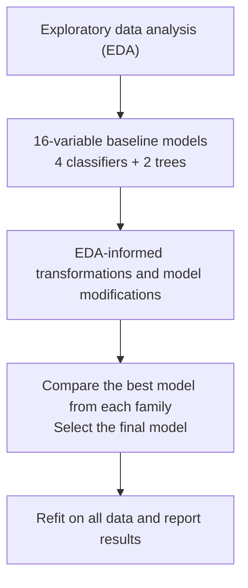

# DSA211 — Online Shoppers Purchase Prediction

**Research question:** Can the features of an online browsing session predict whether it ends in a purchase (`Revenue=1`)?

## Analysis workflow



## Files

- [Group analysis notebook](online_shoppers_analysis.ipynb) — EDA, classification models, tables, figures and conclusions.
- [Online Shoppers UCI dataset](data/online_shoppers.csv) — 12,330 sessions, 17 original predictors and binary outcome `Revenue`. Recorded duplicate rows are preserved.
- [Python environment](requirements.txt) — pinned dependencies for Python 3.12.
- [27 October group meeting](27%20Oct%20Meeting.md) — discussion notes, including items still requiring group agreement.

## Run the notebook

From the repository root:

```bash
python -m pip install -r requirements.txt
jupyter lab
```

Open `online_shoppers_analysis.ipynb` and run its cells in order. The notebook reads `data/online_shoppers.csv`. **No personal-repository scripts, PRDs, version folders or generated artefacts are required.** Tables and figures appear in the notebook itself.

## Method and interpretation

The notebook first compares all **17 original predictors** diagnostically, then evaluates models using **16 predictors** because the availability of `PageValues` at prediction time is uncertain. The modelling families are Logistic Regression, linear discriminant analysis (LDA), Gaussian and Bernoulli Naive Bayes, and classification trees using Gini and Entropy criteria. The latter are compared before and after cost-complexity pruning.

All model comparisons use the same seed-42 stratified 80/20 data split and five training folds. Within-family changes are compared by **mean CV ROC-AUC**, with average precision (AP) and fold variability as supporting evidence. The model identifiers (L0, L1, D0, etc.) are explained immediately below their comparison tables. The notebook displays 26 specified classifier configurations and separately evaluates the tree models.

The chosen model is **L1 Logistic Regression**, using log-transformed browsing activity. Its reported mean training CV ROC-AUC is **0.75747**, and mean AP is **0.33623**. One reserved-set check follows model selection, and the selected specification is then refitted on all 12,330 observations.

**Limitations:** This is a prediction exercise, not causal inference. The reserved test observations were previously examined and therefore **do not provide a pristine independent holdout estimate**. Illustrative contact costs and threshold comparisons do not establish actual upsell profitability. The primary ranking metric and hypothetical business assumptions should be confirmed by the group before final submission.
